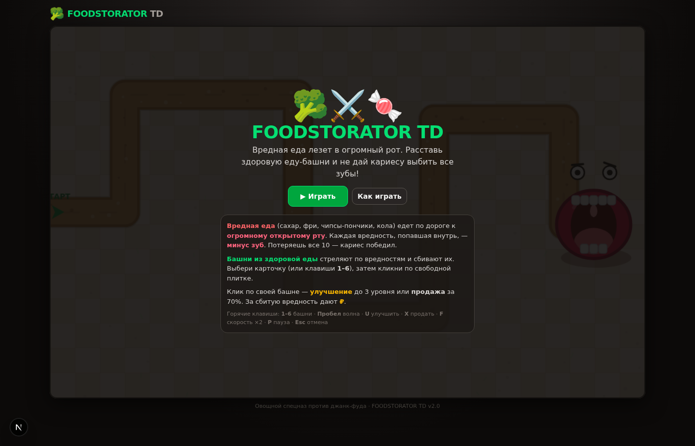
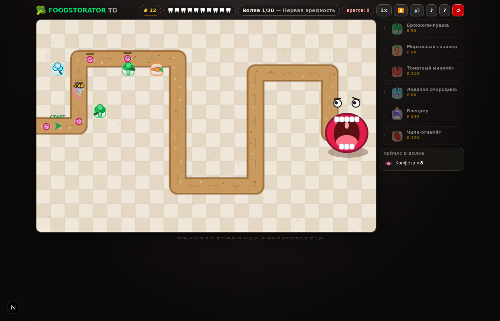
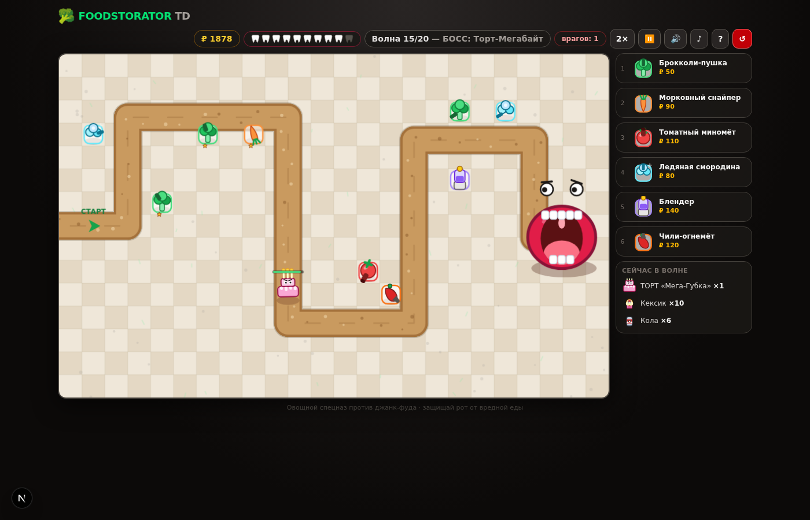

# 🥦 FOODSTORATOR TD

**Классический tower defense про еду**: вредная еда — сахар, чипсы, картошка фри, кола — едет по дороге к **огромному открытому рту**, а на её пути стоят башни из **здоровой еды**: брокколи-пушки, морковные снайперы, чили-огнемёты. Не дай джанк-фуду выбить рту все зубы!

> Версия **v2.0** — полная переделка: классическая формула tower defense, мелкая сетка 40px, 6 разных башен с уникальными механиками, 9 видов вредной еды, 20 волн с боссами, бесконечный режим, векторная графика на Canvas без единого спрайта.

| Меню | Бой | Босс |
|---|---|---|
|  |  |  |

## 🎯 Как играть

1. **Вредная еда едет по дороге** слева направо — к огромному рту. Каждая вредность, попавшая в рот, выбивает **зуб**. Потеряешь все 10 — кариес победил.
2. **Ставь башни** на плитки рядом с дорогой: выбери карточку в магазине (или клавиши **1–6**), затем кликни по свободной клетке.
3. **За сбитую вредность дают ₽**, за пройденную волну — бонус. На них покупай новые башни и улучшай их до 3 уровня.
4. Клик по своей башне — **улучшение** (↑) или **продажа** за 70% (✕).
5. Волна отправляется кнопкой **«▶ Волна N»** (или **Пробел**) — между волнами можно строиться без ограничений по времени.
6. Отбил все **20 волн** — желудок спасён! Дальше открывается **бесконечный режим** с растущей сложностью.

## 🥦 Башни (здоровая еда)

| Башня | Цена | Механика |
|---|---|---|
| 🥦 **Брокколи-пушка** | 50₽ | Базовая скорострельная башня, зелёные горошины |
| 🥕 **Морковный снайпер** | 90₽ | Огромная дальность, мощный одиночный урон |
| 🍅 **Томатный миномёт** | 110₽ | Навесной снаряд, урон **по площади** |
| 🫐 **Ледяная смородина** | 80₽ | Ледяные ягоды **замедляют** врагов |
| 🔌 **Блендер** | 140₽ | Разряд тока, **цепная молния** по нескольким целям |
| 🌶️ **Чили-огнемёт** | 120₽ | Непрерывная струя огня + **поджог** (урон со временем) |

У каждой башни — **3 уровня** (звёздочки под башней).

## 🍬 Вредная еда (враги)

| Вредность | Особенность |
|---|---|
| 🍬 Конфета | Быстрая и хрупкая, идёт большими роями |
| 🍟 Картошка фри | Быстрая, ходит пачкой |
| 🧁 Кексик | Мелкий, но многочисленный |
| 🍩 Пончик | Медленный «середняк» |
| 🥤 Кола | **Очень быстрая**, прорывается на флангах |
| 🍕 Пицца | **Броня 3** — урон снижается на 3 |
| 🍔 Бургер | Толстый танк с бронёй 2 |
| 🍫 Шоколадка | Мини-босс (волны 10, 19, 20) |
| 🎂 Торт «Мега-Губка» | **БОСС** (волны 15 и 20) — 1500+ HP и броня 6 |

## ⌨️ Управление

| Клавиша | Действие |
|---|---|
| **1–6** | Выбрать башню для постройки |
| **Пробел** | Отправить волну |
| **U** / **X** | Улучшить / продать выбранную башню |
| **F** | Скорость ×1 / ×2 |
| **P** | Пауза |
| **Esc** / правый клик | Отмена постройки |

Для тестов можно открыть сразу нужную волну: `http://localhost:3000/?wave=15`.

## 📱 Установка (PWA)

Игра — полноценное PWA: работает офлайн после первой загрузки.

- **iOS**: открыть в Safari → «Поделиться» → «На экран «Домой»».
- **Android**: Chrome → «Установить приложение».
- **Windows**: Chrome/Edge → значок установки в адресной строке.

## 🚀 Запуск

```bash
npm install        # или bun install
npm run dev        # http://localhost:3000
```

Сборка:

```bash
npm run build
npm start
```

Регенерация PWA-иконок (нужен sharp): `node scripts/make-icons.mjs`.

Проверка кода: `npm run lint`.

## 🧱 Технологии

- **Next.js 16 + React 19 + TypeScript**
- **HTML5 Canvas** — игровой движок 60 FPS и вся графика рисуется кодом (ни одной картинки-спрайта)
- **WebAudio API** — процедурные звуки и фоновая музыка (без аудиофайлов)
- **Tailwind CSS 4** — интерфейс, **localStorage** — рекорды
- **PWA** — manifest + service worker, устанавливается на телефон/планшет/ПК

## 📁 Структура

```
src/
  game/
    config.ts    # сетка, дорога, башни, враги, 20 волн, баланс
    engine.ts    # конечный автомат фаз, снаряды, статусы, экономика
    render.ts    # векторная графика: рот, вредности, башни, частицы
    audio.ts     # синтезированные звуки и музыка
    storage.ts   # рекорды в localStorage
    types.ts
  components/game/GameShell.tsx  # HUD, магазин, правила, экраны
public/
  manifest.webmanifest, sw.js, icons/
scripts/
  make-icons.mjs
```

## 🗺 Roadmap

- [ ] Вторая карта с двумя входами
- [ ] Новые башни: кукуруза-миниган, арбузная катапульта, гриб-аура
- [ ] Леткие враги (ментos-ракеты) и летающая еда
- [ ] Мета-прогресс: разблокировка башен за звёзды
- [ ] Уровни 21+ «Мировой фастфуд» с уникальными боссами

---

MIT License · сделано с 🥦 против 🍬
